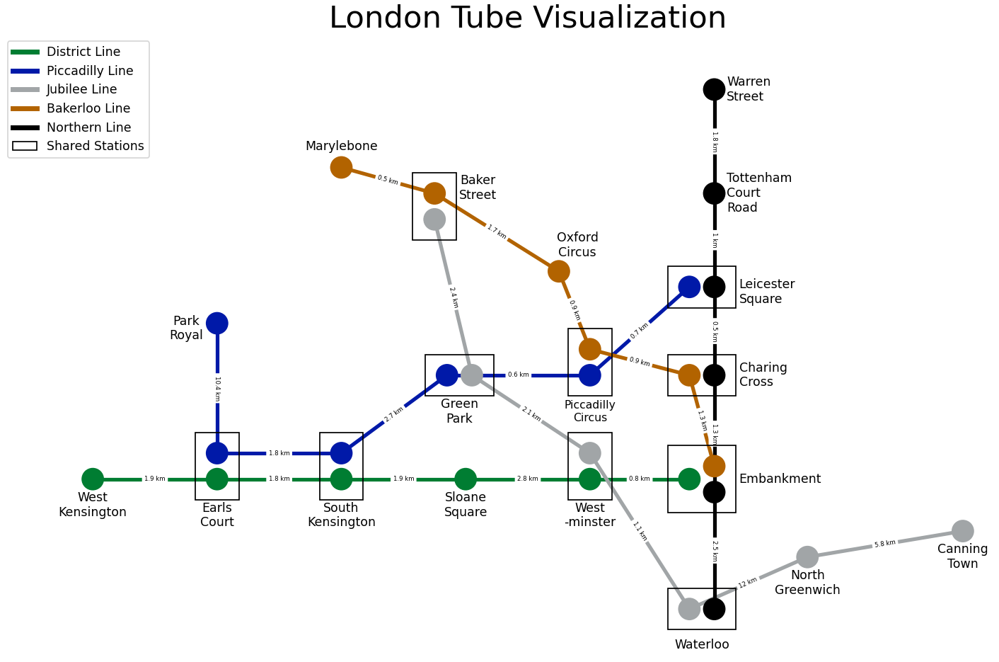

# Python and R Data Science Portfolio

Python and R coursework combining a NetworkX London transport-network visualisation with fraud-data preparation and charts in R. Code, workbook and report.

**Project type:** Two-part programming and data-analysis portfolio.



## What the work covers

- Models selected London Underground connections as a graph with line colours, shared stations and distance labels using NetworkX and Matplotlib.
- Prepares fraud-related workbook tables in R, including Banking and Credit Industry Fraud and Consumer and Retail Fraud categories.
- Uses data reshaping, regional grouping and plots to communicate patterns in the supplied workbook.
- Documents code, outputs and design choices in the combined report.

## Explore the repository

- [Completed portfolio report](COMP1832%20Coursework%20Report.pdf)
- [Python transport-network script](Coursework.py)
- [R notebook](COMP1832_R.ipynb)
- [Input workbook](cw_r.xlsx)

## Run or read the work

For the Python graph, install the listed dependencies and run from the repository root:

```text
python -m pip install -r requirements.txt
python Coursework.py
```

The `.ipynb` file uses R. Inspect its saved outputs on GitHub, or open it with an R-capable notebook environment. Packages used in the report include readxl, dplyr, tidyr and ggplot2. Change the original `/content/cw_r.xlsx` loading path to your local workbook path, retaining the specified sheet and skipped rows.

## Scope and limitations

The transport drawing is a selected teaching network, not a live TfL route planner or a current journey-time service. Fraud charts describe the supplied data and do not establish causation. Original scripts/notebook are preserved; fresh execution in separate Python and R environments has not been verified.

## Academic context

University of Greenwich coursework, COMP-1832-M01. The linked specification, where present, is assessment context rather than a completed project deliverable. Reports and source are preserved in their original form.

The preview is taken from the original report; it is not a newly executed result.
